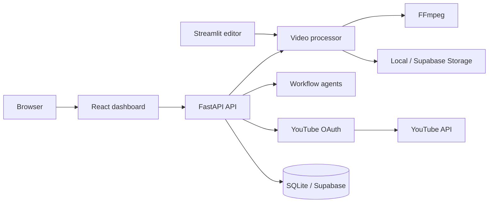

# CreatorOps

CreatorOps is an AI-assisted video production workspace. It combines a FastAPI
backend, a React dashboard, an optional Streamlit editor, FFmpeg media
processing, YouTube OAuth, and Supabase persistence.

## Start here

| Goal | Command |
| --- | --- |
| Install Python dependencies | `python -m pip install -r requirements.txt` |
| Start the FastAPI backend | `npm run backend` |
| Start the React dashboard | `npm run dev` |
| Build the React dashboard | `npm run build` |
| Start the Streamlit editor | `streamlit run CreatorAgent/Frontend/app.py` |
| Run backend tests | `python -m pytest CreatorAgent/Backend/tests` |

The backend serves the built React application when
`CreatorAgent/frontend-react/dist` exists. During development, run the React
dev server separately for hot reload.

## Repository map

```text
CreatorOps/
├── CreatorAgent/
│   ├── Backend/                 FastAPI API and reusable Python services
│   │   ├── agents/              Specialized production workflow agents
│   │   ├── tests/               Backend and pipeline tests
│   │   ├── api_server.py        HTTP routes, auth, jobs, and SPA serving
│   │   ├── video_processor.py   Downloads, validates, and renders media
│   │   ├── db.py                SQLite persistence with Supabase integration
│   │   ├── storage.py           Rendered-media storage abstraction
│   │   └── youtube_auth.py      Google/YouTube OAuth and publishing
│   ├── Frontend/                Optional Streamlit video editor
│   ├── frontend-react/          Primary React + TypeScript dashboard
│   ├── media/                   Local source media; ignored by Git
│   ├── media_output/            Rendered media; ignored by Git
│   └── data/                    Local SQLite data; ignored by Git
├── supabase/migrations/         Versioned database schema changes
├── Dockerfile                   Combined frontend build and API image
├── render.yaml                  Render deployment definition
├── vercel.json                  Vercel frontend deployment definition
└── DEPLOYMENT.md                Secrets and deployment procedures
```

More detailed guides:

- [CreatorAgent architecture](CreatorAgent/README.md)
- [Backend guide](CreatorAgent/Backend/README.md)
- [Agent guide](CreatorAgent/Backend/agents/README.md)
- [Streamlit editor guide](CreatorAgent/Frontend/README.md)
- [React dashboard guide](CreatorAgent/frontend-react/README.md)
- [Database migrations](supabase/README.md)
- [Deployment and security](DEPLOYMENT.md)

## Architecture



The normal production path is:

1. The React dashboard sends an authenticated request to FastAPI.
2. FastAPI validates access, creates a job, and coordinates the agents.
3. The processor downloads or accepts media, validates inputs, and invokes
   FFmpeg for editing.
4. The result is stored locally or in Supabase Storage and exposed through a
   job status/media endpoint.
5. YouTube OAuth is used only when a user connects or publishes to YouTube.

## Configuration and safety

Copy `.env.example` to `.env` and set only the values needed for your
environment. Never commit `.env`, browser cookies, OAuth credentials, tokens,
local databases, or rendered media. See [DEPLOYMENT.md](DEPLOYMENT.md) for the
complete variable reference and production checklist.

Use only media and music that you own or are authorized to process. YouTube
downloads must comply with applicable terms.
